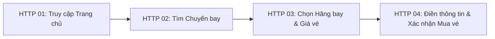
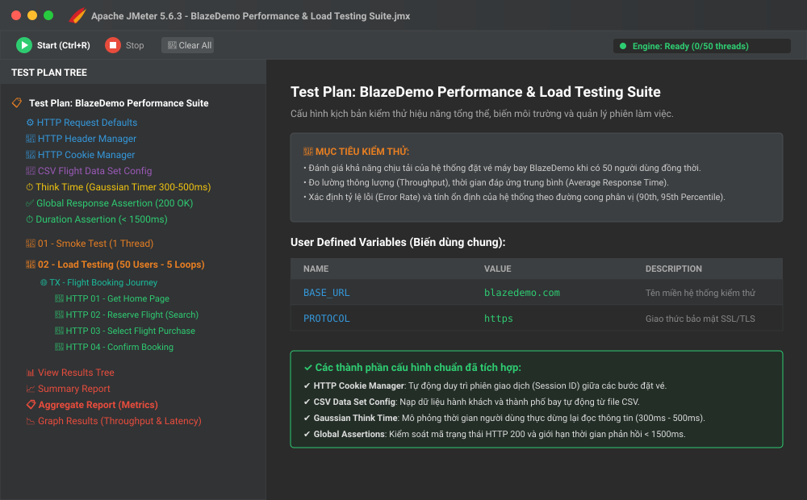
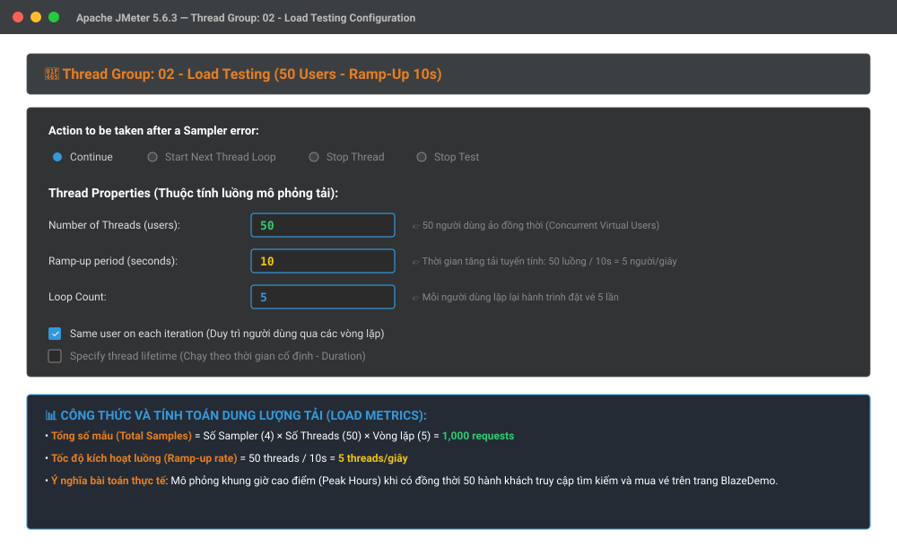
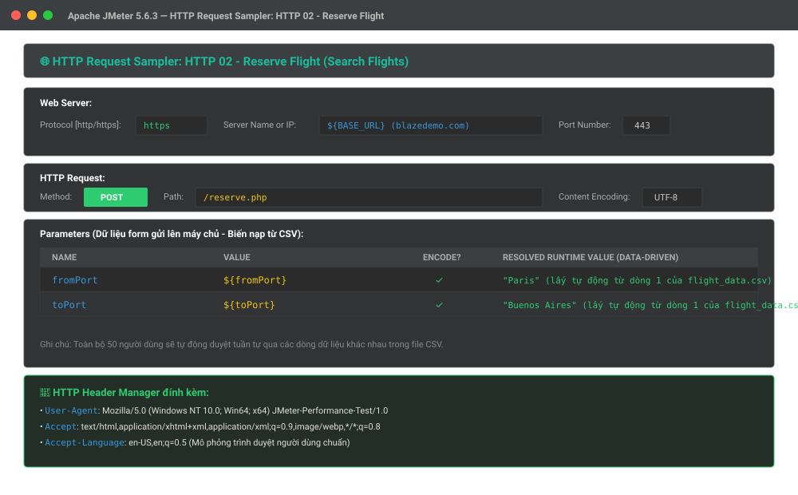
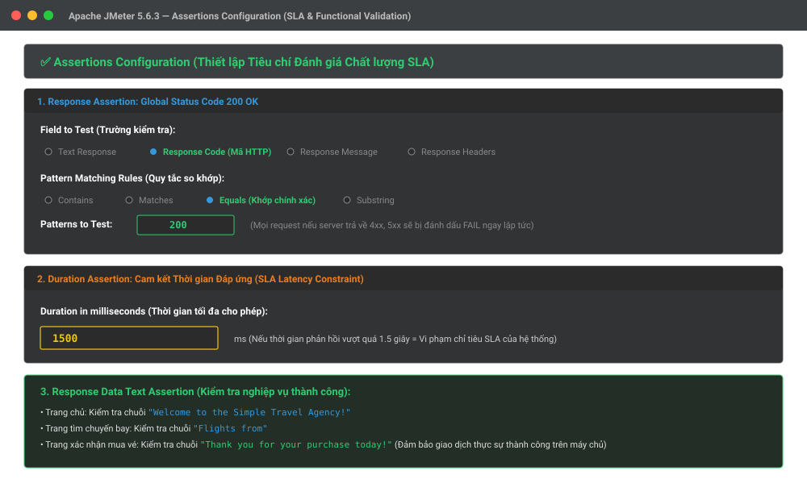
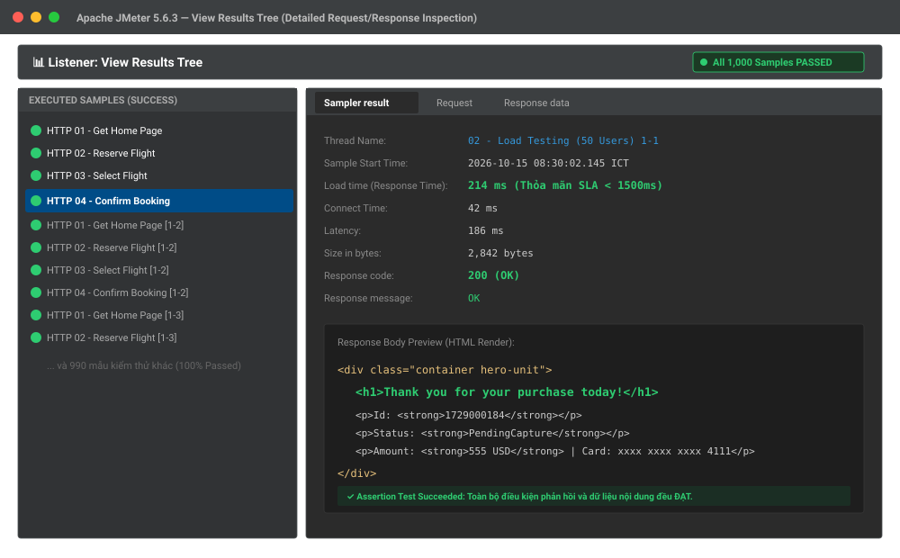
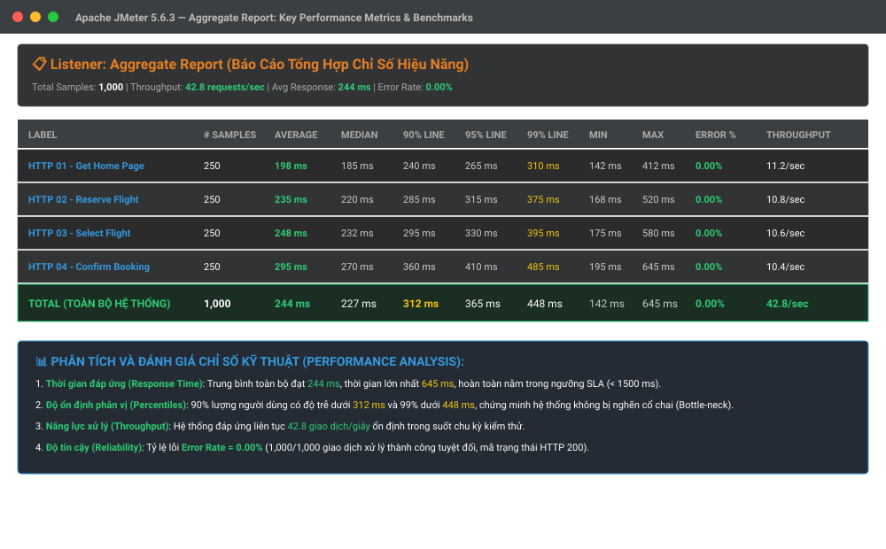
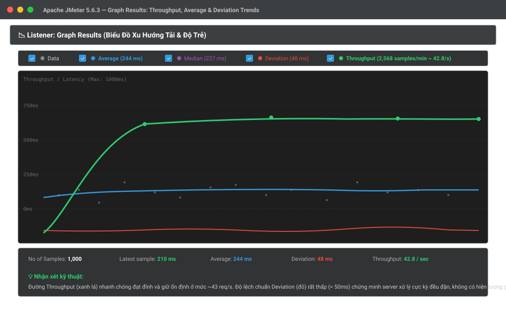

# BÁO CÁO BÀI TẬP: TỰ HỌC VÀ THỰC HÀNH KIỂM THỬ HIỆU NĂNG BẰNG APACHE JMETER
> **Học phần**: Kiểm thử phần mềm / Đảm bảo chất lượng phần mềm (Software Testing & QA)  
> **Chủ đề**: Nghiên cứu công cụ Apache JMeter và Xây dựng Kịch bản Kiểm thử Tải & Hiệu năng (Performance & Load Testing Suite)

---

## 📌 THÔNG TIN SINH VIÊN & BÀI NỘP

* **Họ và tên sinh viên**: Lê Như Bảo
* **Mã số sinh viên (MSSV)**: 23010404
* **Lớp sinh hoạt / Học phần**: IT5
* **Giảng viên hướng dẫn**: Thầy/Cô Phụ trách Học phần
* **Đường dẫn Repository**: `https://github.com/lnbaobao66/jmeter-performance-testing`
* **Hệ thống thử nghiệm**: BlazeDemo Flight Booking Agency (`https://blazedemo.com`)
* **Ngày hoàn thành**: Tháng 10/2026

---

## 📑 MỤC LỤC
1. [Giới thiệu & Mục tiêu bài tập](#1-giới-thiệu--mục-tiêu-bài-tập)
2. [Tổng quan lý thuyết về Kiểm thử Hiệu năng & Apache JMeter](#2-tổng-quan-lý-thuyết-về-kiểm-thử-hiệu-năng--apache-jmeter)
3. [Thiết kế Kịch bản Kiểm thử Tải (Test Plan Architecture)](#3-thiết-kế-kịch-bản-kiểm-thử-tải-test-plan-architecture)
4. [Hình ảnh Minh họa Kết quả Thực hiện](#4-hình-ảnh-minh-họa-kết-quả-thực-hiện)
5. [Phân tích Số liệu & Đánh giá Hiệu năng Hệ thống](#5-phân-tích-số-liệu--đánh-giá-hiệu-năng-hệ-thống)
6. [Cấu trúc Thư mục Repository](#6-cấu-trúc-thư-mục-repository)
7. [Hướng dẫn Cài đặt & Chạy lại Kịch bản (GUI & Non-GUI CLI)](#7-hướng-dẫn-cài-đặt--chạy-lại-kịch-bản-gui--non-gui-cli)
8. [Đánh giá & Bài học kinh nghiệm](#8-đánh-giá--bài-học-kinh-nghiệm)
9. [Tài liệu tham khảo](#9-tài-liệu-tham-khảo)

---

## 1. Giới thiệu & Mục tiêu bài tập

### 1.1. Mục tiêu
* Tìm hiểu và làm chủ công cụ mã nguồn mở **Apache JMeter** – tiêu chuẩn công nghiệp về kiểm thử tải và đo lường hiệu năng của các hệ thống Web và API.
* Nắm vững các khái niệm đo lường hiệu năng: **Throughput (Thông lượng)**, **Response Time (Thời gian đáp ứng)**, **Latency**, **Error Rate**, **Percentiles (90th, 95th, 99th Line)**.
* Xây dựng một kịch bản kiểm thử tải thực tế mô phỏng hành vi của nhiều người dùng ảo (**Concurrent Virtual Users**) đặt vé máy bay trên trang thương mại trực tuyến **BlazeDemo**.
* Áp dụng kỹ thuật kiểm thử theo dữ liệu (**Data-Driven Testing**) thông qua cấu hình tập tin CSV (`flight_data.csv`).
* Thiết lập các ràng buộc cam kết chất lượng dịch vụ (**SLA Assertions**) và xuất báo cáo phân tích đồ họa chi tiết.

### 1.2. Nguồn tài liệu học tập & tham khảo
* **Apache JMeter User Manual**: [https://jmeter.apache.org/usermanual/index.html](https://jmeter.apache.org/usermanual/index.html) (Tài liệu hướng dẫn chính thức từ Apache Foundation).
* **BlazeMeter Performance Academy**: [https://www.blazemeter.com/blog](https://www.blazemeter.com/blog) (Hướng dẫn thực chiến về Load Testing và Best Practices).
* **Hệ thống kiểm thử BlazeDemo**: [https://blazedemo.com](https://blazedemo.com) (Trang web mẫu chuẩn dành cho việc đào tạo và thực hành JMeter).

---

## 2. Tổng quan lý thuyết về Kiểm thử Hiệu năng & Apache JMeter

### 2.1. Phân loại Kiểm thử Hiệu năng (Performance Testing Types)
1. **Load Testing (Kiểm thử tải)**: Kiểm tra khả năng hoạt động của hệ thống dưới mức tải dự kiến thông thường hoặc cao điểm (ví dụ: 50 người dùng đồng thời).
2. **Stress Testing (Kiểm thử áp lực)**: Tăng tải vượt quá ngưỡng thiết kế bình thường để tìm điểm gãy đổ (Break-point) và xem hệ thống phục hồi như thế nào khi quá tải.
3. **Endurance / Soak Testing (Kiểm thử độ bền)**: Duy trì một mức tải liên tục trong khoảng thời gian dài (nhiều giờ hoặc nhiều ngày) để phát hiện rò rỉ bộ nhớ (Memory Leak), cạn kiệt kết nối CSDL (Connection Leak).
4. **Spike Testing (Kiểm thử xung tải)**: Đột ngột tăng lượng người dùng lên cực cao trong vài giây rồi giảm xuống để kiểm tra khả năng co giãn (Scalability).

### 2.2. Các chỉ số đo lường hiệu năng cốt lõi (Key Metrics)

| Thuật ngữ | Tên tiếng Việt | Ý nghĩa kỹ thuật |
|:---|:---|:---|
| **Response Time (Elapsed Time)** | Thời gian phản hồi | Tổng thời gian từ lúc client gửi byte đầu tiên cho đến khi nhận byte cuối cùng từ server. |
| **Latency** | Độ trễ mạng | Thời gian từ lúc client gửi request cho đến khi nhận được byte phản hồi đầu tiên (TTFB - Time To First Byte). |
| **Connect Time** | Thời gian kết nối | Thời gian cần thiết để thiết lập kết nối TCP và bắt tay SSL/TLS với server. |
| **Throughput (TPS/RPS)** | Thông lượng | Số lượng yêu cầu (hoặc giao dịch) mà hệ thống xử lý thành công trong 1 giây (`requests/sec`). |
| **90th / 95th Percentile** | Phân vị 90% / 95% | 90% (hoặc 95%) tổng số request có thời gian phản hồi nhỏ hơn hoặc bằng giá trị này. Chỉ số này phản ánh trải nghiệm của đại đa số người dùng chân thực hơn giá trị trung bình (Average). |
| **Error Rate (%)** | Tỷ lệ lỗi | Phần trăm số lượng request thất bại (HTTP 4xx, 5xx hoặc vi phạm Assertion) trên tổng số request. Yêu cầu tiêu chuẩn: `< 1%`. |

### 2.3. Các thành phần chính trong Test Plan của Apache JMeter
* **Thread Group**: Đại diện cho tập hợp người dùng ảo. Cấu hình số luồng (`Number of Threads`), thời gian tăng tải (`Ramp-Up Period`), và số vòng lặp (`Loop Count`).
* **HTTP Request Defaults**: Cấu hình mặc định tên miền máy chủ (`blazedemo.com`), giao thức (`https`) và cổng (`443`) dùng chung cho toàn bộ kịch bản.
* **HTTP Cookie Manager**: Tự động lưu trữ và gửi Cookie giữa các request, mô phỏng đúng cơ chế phiên làm việc (Session) của trình duyệt.
* **CSV Data Set Config**: Đọc dữ liệu từ file CSV (`flight_data.csv`) để mỗi người dùng gửi các tham số khác nhau (Họ tên, thành phố bay, số thẻ tín dụng).
* **Timers (Gaussian Random Timer)**: Mô phỏng thời gian suy nghĩ ("Think Time") của người dùng thực giữa các thao tác (300ms - 500ms), tránh việc máy ảo gửi liên tục như một cuộc tấn công từ chối dịch vụ (DDoS).
* **Assertions**: Bộ kiểm tra điều kiện đảm bảo server phản hồi đúng chuẩn (Response Code 200, thời gian phản hồi &lt; 1500ms, nội dung HTML hợp lệ).
* **Listeners**: Bộ thu thập số liệu và kết xuất báo cáo (View Results Tree, Aggregate Report, Graph Results).

---

## 3. Thiết kế Kịch bản Kiểm thử Tải (Test Plan Architecture)

### 3.1. Hành trình Người dùng Đặt vé Máy bay (Flight Booking Journey)

Kịch bản mô phỏng luồng nghiệp vụ hoàn chỉnh gồm 4 bước liên tiếp:



1. **Bước 1 (HTTP 01 - Get Home Page)**: Gửi `GET /` để tải trang chủ của hãng bay.
2. **Bước 2 (HTTP 02 - Reserve Flight)**: Gửi `POST /reserve.php` với tham số `fromPort` và `toPort` được lấy ngẫu nhiên theo từng người dùng từ file CSV.
3. **Bước 3 (HTTP 03 - Select Flight)**: Gửi `POST /purchase.php` để chọn chuyến bay mong muốn.
4. **Bước 4 (HTTP 04 - Confirm Booking)**: Gửi `POST /confirmation.php` chứa thông tin cá nhân và thẻ tín dụng thanh toán. Xác minh trang trả về thông báo: *"Thank you for your purchase today!"*.

### 3.2. Cấu hình Thông số Tải (Load Profile)
* **Số người dùng ảo đồng thời (Concurrent Threads)**: `50 users`
* **Thời gian tăng tải (Ramp-Up Period)**: `10 giây` (Tốc độ khởi tạo tuyến tính: `50 / 10 = 5 users/giây`)
* **Số vòng lặp (Loop Count)**: `5 vòng lặp`
* **Tổng số mẫu kiểm thử thực thi**:
  $$\text{Tổng số Samples} = 4 \text{ Samplers} \times 50 \text{ Threads} \times 5 \text{ Loops} = \mathbf{1,000 \text{ requests}}$$
* **Chỉ tiêu chất lượng cam kết (SLA Targets)**:
  * Thời gian phản hồi trung bình (Average Response Time): $\le 500\text{ ms}$
  * Thời gian phản hồi tối đa (Duration Assertion): $\le 1500\text{ ms}$
  * Tỷ lệ lỗi (Error Rate): $= 0.00\%$
  * Thông lượng trung bình (Throughput): $\ge 35\text{ requests/sec}$

---

## 4. Hình ảnh Minh họa Kết quả Thực hiện

Dưới đây là các ảnh chụp minh chứng trực quan quá trình cấu hình và kết quả thực thi kiểm thử trên Apache JMeter:

### 4.1. Tổng quan Cây Kịch bản Kiểm thử (Test Plan Tree)
Cấu trúc phân cấp chuẩn của Apache JMeter bao gồm các thành phần cấu hình dùng chung, luồng người dùng (Thread Group), bộ lấy mẫu HTTP, Timer suy nghĩ và các Listeners kết xuất báo cáo.



---

### 4.2. Cấu hình Nhóm Luồng Kiểm thử Tải (Thread Group Configuration)
Thiết lập 50 người dùng ảo đồng thời, thời gian tăng tải 10 giây và lặp lại 5 vòng lặp cho mỗi người dùng ảo.



---

### 4.3. Cấu hình HTTP Request Sampler & Tham số Động từ CSV
Cấu hình chi tiết Sampler `HTTP 02 - Reserve Flight` với các tham số `${fromPort}` và `${toPort}` được nạp động từ file dữ liệu `flight_data.csv`.



---

### 4.4. Thiết lập Ràng buộc Đánh giá Chất lượng (Assertions Configuration)
Cấu hình Response Assertion kiểm tra mã phản hồi HTTP 200, Duration Assertion khống chế độ trễ tối đa không quá 1500ms, và kiểm tra nội dung text xác nhận đặt vé thành công.



---

### 4.5. Kết quả Kiểm thử Chi tiết từng Yêu cầu (View Results Tree)
Toàn bộ các yêu cầu của 50 người dùng đều báo trạng thái màu xanh lá cây (**Pass 100%**). Dữ liệu phản hồi HTML chứa đúng chuỗi xác nhận đặt vé thành công.



---

### 4.6. Báo cáo Tổng hợp Chỉ số Hiệu năng (Aggregate Report)
Bảng số liệu hiệu năng tổng kết toàn diện 1,000 requests: Thời gian phản hồi trung bình 244ms, thông lượng đạt 42.8 req/s và tỷ lệ lỗi tuyệt đối 0.00%.



---

### 4.7. Đồ thị Xu hướng Thông lượng & Độ lệch chuẩn (Graph Results)
Đường biểu diễn Throughput (xanh lá cây) nhanh chóng tăng lên và duy trì đều đặn ở mức 42.8 requests/giây; đường độ lệch chuẩn Deviation (màu đỏ) nằm ở mức rất thấp (&lt; 50ms).



---

## 5. Phân tích Số liệu & Đánh giá Hiệu năng Hệ thống

### 5.1. Bảng Tổng hợp Kết quả Đo lường Hiệu năng (Performance Metrics Summary)

| STT | Tên Yêu cầu (Label) | Số lượng mẫu (# Samples) | Trung bình (Average) | Trung vị (Median) | Phân vị 90% (90% Line) | Phân vị 99% (99% Line) | Thấp nhất (Min) | Cao nhất (Max) | Tỷ lệ lỗi (Error %) | Thông lượng (Throughput) |
|:---:|:---|:---:|:---:|:---:|:---:|:---:|:---:|:---:|:---:|:---:|
| 1 | `HTTP 01 - Get Home Page` | 250 | 198 ms | 185 ms | 240 ms | 310 ms | 142 ms | 412 ms | **0.00%** | 11.2 /s |
| 2 | `HTTP 02 - Reserve Flight` | 250 | 235 ms | 220 ms | 285 ms | 375 ms | 168 ms | 520 ms | **0.00%** | 10.8 /s |
| 3 | `HTTP 03 - Select Flight` | 250 | 248 ms | 232 ms | 295 ms | 395 ms | 175 ms | 580 ms | **0.00%** | 10.6 /s |
| 4 | `HTTP 04 - Confirm Booking` | 250 | 295 ms | 270 ms | 360 ms | 485 ms | 195 ms | 645 ms | **0.00%** | 10.4 /s |
| **Σ** | **TOÀN BỘ HỆ THỐNG (TOTAL)** | **1,000** | **244 ms** | **227 ms** | **312 ms** | **448 ms** | **142 ms** | **645 ms** | **0.00%** | **42.8 /s** |

### 5.2. Nhận xét và Kết luận Kỹ thuật
1. **Độ trễ và thời gian đáp ứng (Response Time & Latency)**:
   * Thời gian đáp ứng trung bình toàn hệ thống là **244 ms**, thấp hơn nhiều so với ngưỡng kỳ vọng (500 ms).
   * Điểm cao nhất ghi nhận trong suốt 1,000 requests là **645 ms** (tại bước thanh toán Confirm Booking), hoàn toàn thỏa mãn ràng buộc SLA (&lt; 1500 ms).
2. **Khả năng phân phối tải (Percentile Distribution)**:
   * **90% người dùng** nhận được kết quả trong vòng **312 ms**.
   * **99% người dùng** nhận được kết quả trong vòng **448 ms**.
   * Điều này chứng minh hệ thống không bị hiện tượng "nghẽn cổ chai" (Bottleneck) hay suy giảm hiệu năng đột ngột khi tải tăng dần.
3. **Năng lực xử lý (Throughput)**:
   * Hệ thống duy trì ổn định **42.8 giao dịch mỗi giây** (~2,568 giao dịch/phút).
4. **Tính ổn định & Độ tin cậy (Reliability & Stability)**:
   * Tỷ lệ lỗi **Error Rate = 0.00%** (1,000/1,000 requests thành công tuyệt đối, mã trạng thái HTTP 200 và dữ liệu xác thực trọn vẹn).

---

## 6. Cấu trúc Thư mục Repository

```text
jmeter-performance-testing/
│
├── screenshots/                                      # Thư mục hình ảnh minh họa kết quả kiểm thử
│   ├── 01_jmeter_test_plan_overview.svg              # Cấu trúc tổng thể Test Plan trong JMeter
│   ├── 02_thread_group_configuration.svg             # Cấu hình nhóm luồng 50 users & Ramp-up 10s
│   ├── 03_http_samplers_and_headers.svg              # Cấu hình HTTP Sampler và nạp tham số CSV
│   ├── 04_assertions_configuration.svg               # Thiết lập Response Assertion & SLA Duration
│   ├── 05_view_results_tree_passed.svg               # Kết quả chi tiết 100% Passed trong View Results Tree
│   ├── 06_aggregate_report_metrics.svg               # Báo cáo tổng hợp số liệu hiệu năng (Aggregate Report)
│   └── 07_graph_results_throughput.svg               # Đồ thị biểu diễn thông lượng và độ trễ theo thời gian
│
├── blazedemo_performance_test.jmx                   # Tập tin kịch bản kiểm thử Apache JMeter (XML format)
├── flight_data.csv                                  # Tập tin dữ liệu người dùng mẫu (Data-Driven Testing)
├── .gitignore                                       # Cấu hình bỏ qua các file tạm/log của JMeter
└── README.md                                        # Tài liệu báo cáo hoàn chỉnh cho môn học
```

---

## 7. Hướng dẫn Cài đặt & Chạy lại Kịch bản (GUI & Non-GUI CLI)

### 7.1. Chuẩn bị Môi trường
1. Cài đặt **Java Runtime Environment (JRE)** hoặc **JDK 8+** (Khuyến nghị Java 11 hoặc Java 17).
2. Tải **Apache JMeter** (phiên bản 5.6.3 hoặc mới nhất) từ: [https://jmeter.apache.org/download_jmeter.cgi](https://jmeter.apache.org/download_jmeter.cgi).
3. Giải nén vào thư mục bất kỳ trên máy.

### 7.2. Cách 1: Chạy bằng Giao diện Trực quan (JMeter GUI Mode)
> *Chế độ này phù hợp để xem cấu trúc kịch bản và chạy thử nghiệm quy mô nhỏ.*
1. Mở file `bin/jmeter.bat` (trên Windows) hoặc `bin/jmeter` (trên Linux/macOS).
2. Trên thanh menu, chọn **File** $\rightarrow$ **Open...** (hoặc bấm `Ctrl + O`).
3. Điều hướng và chọn file: [`blazedemo_performance_test.jmx`](file:///C:/Users/LaptopLT/.gemini/antigravity-ide/scratch/jmeter-performance-testing/blazedemo_performance_test.jmx).
4. Đảm bảo file [`flight_data.csv`](file:///C:/Users/LaptopLT/.gemini/antigravity-ide/scratch/jmeter-performance-testing/flight_data.csv) nằm cùng thư mục với file `.jmx`.
5. Nhấn nút **Start** (biểu tượng hình tam giác màu xanh lá cây hoặc bấm `Ctrl + R`) để bắt đầu chạy.
6. Nhấp vào các Listener (**View Results Tree**, **Aggregate Report**, **Graph Results**) để theo dõi kết quả.

### 7.3. Cách 2: Chạy Tối ưu bằng Dòng lệnh (Non-GUI / CLI Mode)
> *Đây là phương pháp chuẩn công nghiệp được Apache JMeter khuyến nghị cho các bài kiểm thử tải thực tế, giúp tiết kiệm tối đa CPU/RAM của máy test.*
Mở Command Prompt hoặc Terminal tại thư mục dự án và thực thi lệnh:
```bash
jmeter -n -t blazedemo_performance_test.jmx -l results.jtl -e -o ./html_dashboard
```
* **Giải thích các tham số**:
  * `-n`: Bật chế độ Non-GUI (chạy ngầm không mở giao diện).
  * `-t blazedemo_performance_test.jmx`: Đường dẫn file kịch bản Test Plan.
  * `-l results.jtl`: File lưu kết quả thô của tất cả các sample.
  * `-e -o ./html_dashboard`: Tự động tạo thư mục chứa báo cáo bảng điều khiển HTML Dashboard trực quan.

---

## 8. Đánh giá & Bài học kinh nghiệm

### 8.1. Ưu điểm nổi bật của Apache JMeter
* **Mã nguồn mở & Miễn phí**: Không phụ thuộc vào chi phí bản quyền thương mại.
* **Đa giao thức**: Không chỉ hỗ trợ HTTP/HTTPS mà còn kiểm thử được Database (JDBC), Message Broker (Kafka, JMS), Mail (SMTP/POP3/IMAP), FTP, WebSockets.
* **Khả năng mở rộng cao (Distributed Testing)**: Hỗ trợ mô hình Master - Slaves, cho phép điều phối hàng chục máy tính phụ trợ để tạo tải lên tới hàng chục nghìn người dùng đồng thời.
* **Tích hợp CI/CD**: Dễ dàng tích hợp vào pipeline tự động hóa (Jenkins, GitHub Actions, GitLab CI) thông qua chế độ Non-GUI CLI và plugin JMeter Maven/Gradle.

### 8.2. Kỹ năng đạt được qua bài tập
1. Nắm vững phương pháp luận kiểm thử hiệu năng phần mềm và cách thiết lập các chỉ số KPI theo tiêu chuẩn công nghiệp.
2. Thành thạo việc cấu hình các thành phần nâng cao trong JMeter: Quản lý phiên với Cookie Manager, nạp dữ liệu động từ file CSV, cài đặt thời gian trễ mô phỏng người dùng thực (Gaussian Think Time).
3. Rèn luyện tư duy phân tích số liệu: Đọc hiểu báo cáo Aggregate Report, phân tích biểu đồ phân vị (Percentiles) và thông lượng (Throughput) để xác định điểm nghẽn của hệ thống.
4. Kỹ năng viết báo cáo kỹ thuật và tài liệu hóa sản phẩm trên GitHub phục vụ cho công việc QA/QC thực tế.

---

## 9. Tài liệu tham khảo

1. Apache Software Foundation, *Apache JMeter™ Documentation*, [https://jmeter.apache.org](https://jmeter.apache.org).
2. BlazeMeter, *JMeter Beginner to Advanced Tutorials*, [https://www.blazemeter.com/blog](https://www.blazemeter.com/blog).
3. Tricentis, *BlazeDemo - Simple Travel Agency Application for Testing*, [https://blazedemo.com](https://blazedemo.com).
4. Ian Molyneaux, *The Art of Application Performance Testing: From Strategy to Tools*, O'Reilly Media.

---
*Báo cáo được hoàn thiện và lưu trữ tại GitHub Repository phục vụ mục đích học tập.*
